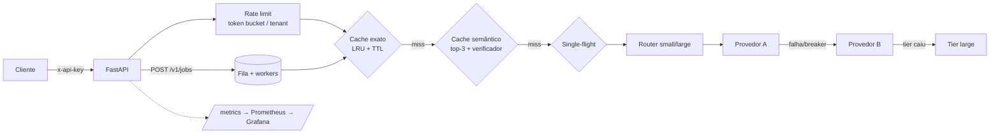

# inference-gateway

Gateway HTTP para chamadas a LLMs: **cache exato + cache semântico com verificador**, coalescência de requisições idênticas, roteamento small/large por complexidade, **retry + fallback + circuit breaker**, rate limit por chave, contabilidade de custo por tenant, jobs assíncronos e métricas Prometheus. O foco é medir o que cada camada economiza **e o que ela erra**.

> **Leia isto primeiro.** Os provedores nos benchmarks são **simulados** (150 ms small / 600 ms large ±20%, preços *ilustrativos* configuráveis, não de nenhum provedor real). Os números mostram o efeito das camadas do gateway e seu overhead, não a latência/custo de um LLM real. `AnthropicProvider` existe mas **não foi exercitado ao vivo**.

## Resultados (`make bench`; 1500 req, concorrência 32, workload Zipf com 35% de paráfrases leves; gerador de carga na mesma máquina)
| cenário | erros | req/s | p50 ms | p95 ms | custo simulado | resposta errada servida |
|---|---|---|---|---|---|---|
| sem cache (só single-flight) | 0 | 213 | 150 | 210 | baseline | – |
| cache exato | 0 | 283 | 72 | 294 | **−70%** | 0 |
| exato + semântico **+ verificador** | 0 | 260 | 86 | 330 | **−86%** | **0 / 357 hits semânticos** |
| exato + semântico, sem verificador | 0 | 255 | 90 | 322 | −90% | **6 / 382 (1,6%)** |
| sem cache, primário com 30% de falha | 0 | 149 | 169 | 450 | ≈ baseline | – |

Leitura honesta:
- **Mediana cai ~50%, mas o p95 *sobe*** nos cenários com cache. Hipótese (não isolada experimentalmente): com a maioria dos pedidos virando hit, o percentil 95 passa a cair entre os misses, que incluem chamadas ao tier large (600 ms), e o gerador de carga disputa CPU com o servidor.
- O baseline já inclui *single-flight* (626 das 1500 requisições foram coalescidas), então a economia atribuída ao cache é **conservadora** em relação a um gateway sem nenhuma deduplicação.
- Com 30% de falha no provedor primário: **0 erros** para o cliente (fallback + breaker), ao custo de throughput menor e cauda maior.
- O verificador reduz a economia (−90% → −86%) para eliminar respostas erradas: troca explícita de recall por precisão ([ADR 0001](docs/adr/0001-semantic-cache-verifier.md)).

### Curva do limiar do cache semântico (`bench/threshold_curve.py`; 20 paráfrases leves, 20 fortes, 41 negativos difíceis)
Tabela completa em [bench/results/threshold_curve.md](bench/results/threshold_curve.md). Em 0,8: só embedding → hit leve 100%, **FP 26,8%**; com verificador → hit leve 90%, **FP 0%**. **Paráfrases fortes: 0% de acerto em qualquer limiar** (o embedder por hashing não captura sinonímia — é o limite desta versão). O verificador foi desenhado olhando esse conjunto; por isso há um conjunto **held-out** de 8 positivos / 15 negativos escritos depois: 5/8 hits, **0/15 falsos positivos** (amostra pequena; limite superior de 95% ≈ 20%).

## Arquitetura

Cache e jobs são isolados por tenant. Falhas não envenenam o cache (teste cobre). Jobs: idempotency-key, 503 + `Retry-After` com fila cheia.

## Rodando
```bash
make install && make test          # 20 testes
make bench                         # curva de limiar + teste de carga (≈1 min, sem rede)
uvicorn gateway.app:app --port 8000
curl -s localhost:8000/v1/chat -H 'x-api-key: dev-key' -H 'content-type: application/json' -d '{"prompt":"Qual o prazo de reembolso no Pix?"}'
curl -s localhost:8000/metrics | head
docker compose up --build          # + Prometheus (9090) e Grafana (3000) com dashboard provisionado
```
Variáveis: `GATEWAY_CACHE=none|exact|semantic`, `SEMANTIC_THRESHOLD`, `SEMANTIC_VERIFY`, `MOCK_LATENCY_SMALL/LARGE`, `MOCK_FAIL_RATE`, `GATEWAY_API_KEYS=k:tenant,...`, `RATE_LIMIT_RPS/BURST`.
A imagem do gateway foi construída e exercitada via curl (chat + hit semântico). O `docker-compose.yml` completo (Prometheus + Grafana) e o dashboard (`ops/grafana/dashboards/`) **não foram executados** — validar na primeira subida.

## Limitações conhecidas
- Fila e caches em memória (uma réplica); ver [ADR 0002](docs/adr/0002-in-memory-queue.md). Próximo passo: Redis para caches e RabbitMQ para jobs.
- Embedder por hashing e verificador lexical não substituem embedding neural + verificador de equivalência.
- Sem streaming SSE, sem timeout por provedor além do cliente HTTP, preços ilustrativos.
- Roteador por heurística de regex/tamanho, não por classificador treinado.
